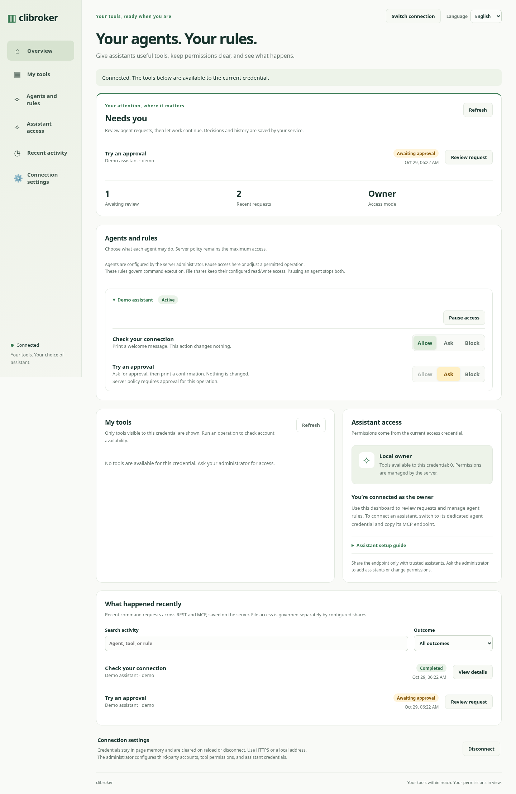
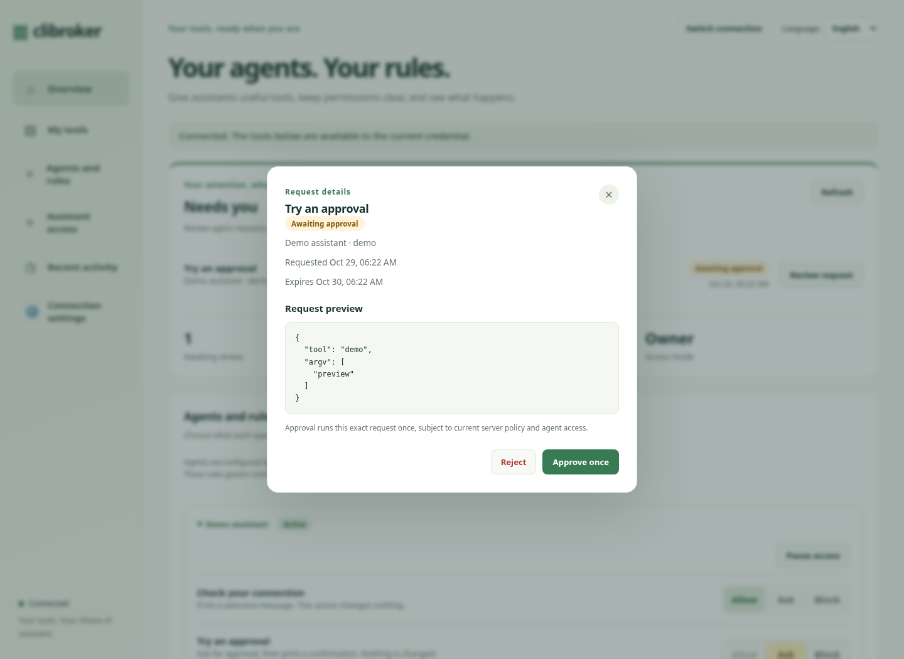
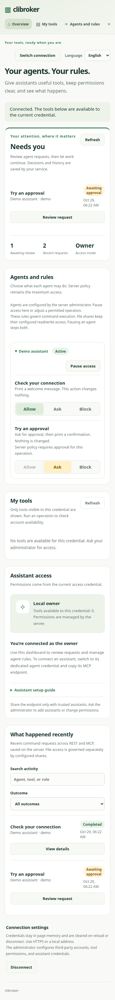

# Control dashboard acceptance — 2026-10-29

The dashboard was checked against a real local FastAPI server and harmless Python
subprocesses, including the configuration produced by `clibroker init`. No external
accounts were connected and no production actions were performed.

## Automated checks

- Python 3.12 / MCP SDK 2.3.0: `.venv/bin/python -m pytest tests -v` — 312 passed.
- `node --test tests/dashboard_*.test.cjs` — 22 passed.
- `uv build` — source distribution and wheel built successfully.
- Compile and `git diff --check` passed.

Security regression coverage includes owner/agent isolation, policy and RBAC
ceilings, concurrent approval claims, restart persistence, expiry, configuration
drift, interrupted operations, paused file/MCP access, direct MCP factory scope,
and rejecting databases inside exposed shares. An independent failure probe
confirmed a result-storage failure cannot cause an approved request to execute
again on retry.

## Chromium acceptance

Real Chromium was exercised with local test servers and temporary credentials:

- Agent request → owner review → approved result; rejection and repeated approval.
- Owner pause/resume and Allow/Ask/Block controls.
- History after page reload/reconnect and full server restart.
- Generated first-run configuration and approval deep links after owner login.
- Owner credentials with no command grants still display friendly request labels.
- Agent history isolation, English/Chinese switching, and legacy control-disabled mode.
- Authenticated artifact download with exact content verification.
- Polling preserves focused controls; a delayed old detail response cannot replace a new selection.
- Desktop 1440px and mobile 390px/320px widths without horizontal overflow.
- No browser page errors during acceptance.

The final targeted browser pass covered the compact connected layout, hidden owner
MCP-copy action, readable approval labels, keyboard focus, and stale responses.

## Screenshots

## Scope

This verifies configured agents and command approvals. Third-party account
onboarding, remote HTTPS/proxy deployment, real providers, Safari/Firefox, and
physical devices were not tested. CLI accounts and agent credentials are configured
on the server. File-share access retains separate configured permissions; command
approvals do not implement per-file approvals. History is bounded local storage,
not an unlimited audit archive.
