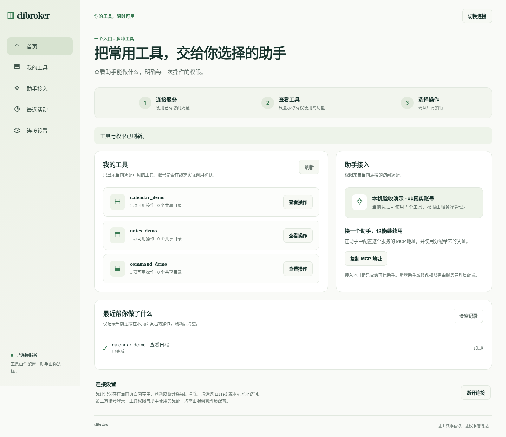
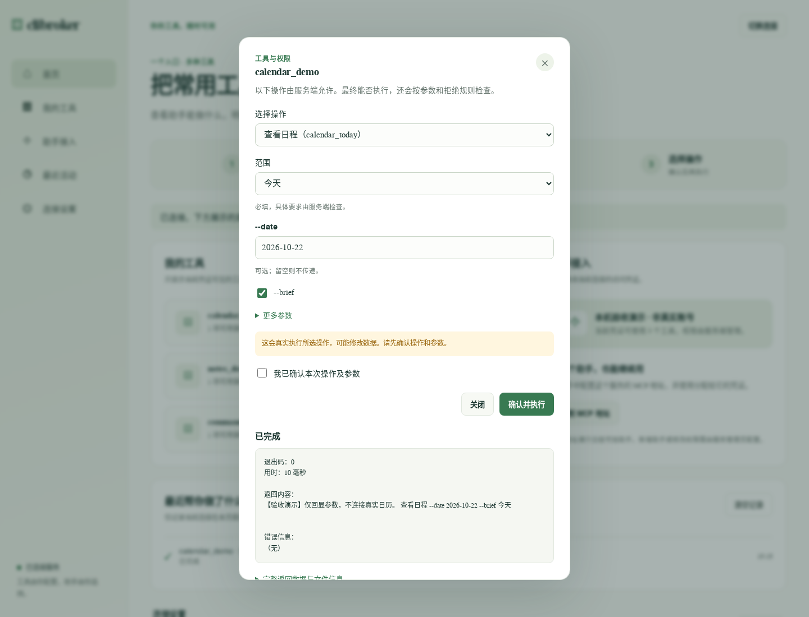
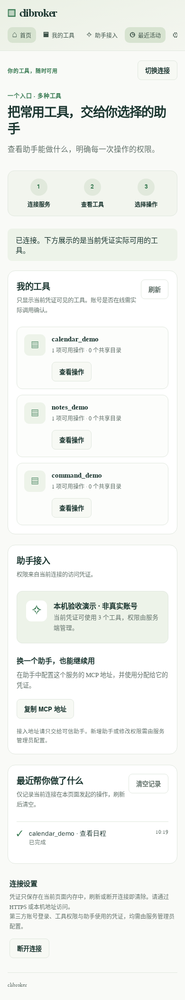

# 浏览器面板验收记录

验收时间：2026-10-22（UTC）。验收对象为 PR #5 的应用代码，基于 `1f0e729caf43ddbdc1ca819075c9b34273d0890d`，包含本次发现并修正的手机工具卡片布局。

## 环境与数据

- Python 3.13.5，MCP 1.30.0，真实 Chromium 156.0.8078.4，由 Playwright 驱动。
- 在隔离虚拟环境安装本仓库，以 `clibroker --config <临时演示配置>` 启动真实 Python 服务，仅监听 `127.0.0.1:8876`，访问 `/dashboard/`。
- 桌面视口为 1440 × 1100；手机视口为 390 × 844，另检查 320 像素宽度。
- 临时生成两组演示凭证，分别授权三个工具和一个工具。三个演示工具只运行 `/usr/bin/echo`，仅回显输入，不访问真实日历、笔记、用户账号或生产服务。
- 页面明确显示“本机验收演示 · 非真实账号”；执行输出也标注“验收演示”。未用响应替身伪造接口结果，截图来自真实浏览器运行页面。
- 截图没有凭证输入框内容或敏感 MCP 接入地址。服务和浏览器在验收结束后关闭。

## 自动测试

在仓库根目录执行：

```bash
<隔离虚拟环境>/bin/python -m pytest tests -v --basetemp=<临时目录>/pytest-final
```

最终结果：**187 项通过，耗时 5.25 秒，退出码 0**。输出见[测试日志](acceptance/dashboard-pytest.log)，仅将本机目录替换为 `<workspace>`。

原 PR 创建时尚未运行自动测试或浏览器验收；上述结果是本次补充执行所得。

## 真实浏览器验收

| 检查项 | 实际结果 |
| --- | --- |
| 首次打开 `/dashboard/` | 页面正常显示，初始未连接；响应包含限制性的内容安全策略 |
| 无效演示凭证 | `/client-config` 返回 401，页面显示中文错误，不进入已连接状态 |
| 有效演示凭证 | 真实调用 `/client-config`，显示三个获授权工具；未授权工具和拒绝规则不显示 |
| 参数表单 | 显示必填位置参数、可选值参数和独立开关；未确认时不会发出执行请求 |
| 修改参数 | 已勾选的执行确认自动取消，需要重新确认 |
| 确认执行 | 真实调用 `/execute` 并启动 `/usr/bin/echo`；返回成功、退出码 0、实际输出和匹配规则 |
| 结果与活动 | 中文结果区显示输出；本页出现一条成功活动，刷新工具列表不会清除它 |
| 通配命令与原始参数 | 输入具体命令片段和 JSON 参数数组，实际执行回显，不把 `*` 当作字面命令 |
| 切换凭证 | 切换到仅授权一个工具的凭证后，只显示一个工具，同时清空原活动 |
| 断开与重新加载 | 断开后工具清空；重新加载页面后连接被遗忘；浏览器本地和会话存储均为空 |
| 直接访问 `index.html` | `/dashboard/index.html` 可以正常连接，接口地址解析正确 |
| 手机操作 | 390 像素宽度下完成连接、填写参数、确认执行、显示活动；390 和 320 像素均无页面横向溢出 |
| 浏览器诊断 | 无 JavaScript 页面异常、无意外控制台错误、无失败网络请求、无外部网络请求 |

无效凭证场景产生 **一条预期的 HTTP 401 控制台错误**，已在[浏览器验收数据](acceptance/dashboard-browser.json)中记录，不计作意外错误。

本次发现手机工具卡片的名称被按钮挤窄，长名称会拆行。仅调整手机样式，让工具文字占据完整可用行宽，按钮放到下一行；修复后重新执行整个浏览器流程，三个演示名称在 390 像素下均不拆行。

## 实际截图

### 桌面首页

显示已连接的演示凭证、三个获授权工具和实际执行产生的活动。



### 执行结果

实际请求经过认证、策略检查和子进程执行，结果区显示演示回显与退出码。



### 手机窄屏

390 像素宽度；工具名称与按钮分行，下面的活动来自同一手机浏览器中完成的操作。



## 限制与失败记录

- 首次按未设上限的项目依赖安装时选中了 MCP 2.3.0，现有后端在导入 `mcp.server.fastmcp` 时失败，服务无法启动。此次隔离环境改用兼容的 **MCP 1.30.0** 后完成验收；没有修改项目依赖范围，也没有证明 MCP 2.x 兼容。
- 中断恢复时，早先的浏览器脚本曾因没有等待对话框 `close` 事件、按钮可访问名称选择错误而失败；这些是验收脚本问题，已修正后重新运行。另一次重验因临时服务已退出而收到连接拒绝，随后将服务和浏览器放在同一次受控运行内，完整复验通过。先前的失败记录不作为通过证据。
- 未验证真实第三方 CLI 账号、OAuth 登录、助手到 MCP 的端到端接入、远程 HTTPS 或代理部署。
- 未验证 Firefox、Safari 或实体手机；手机结果是 Chromium 的窄屏浏览器验收。
- 未部署、未合并 PR。所有演示数据仅用于本机验收。
