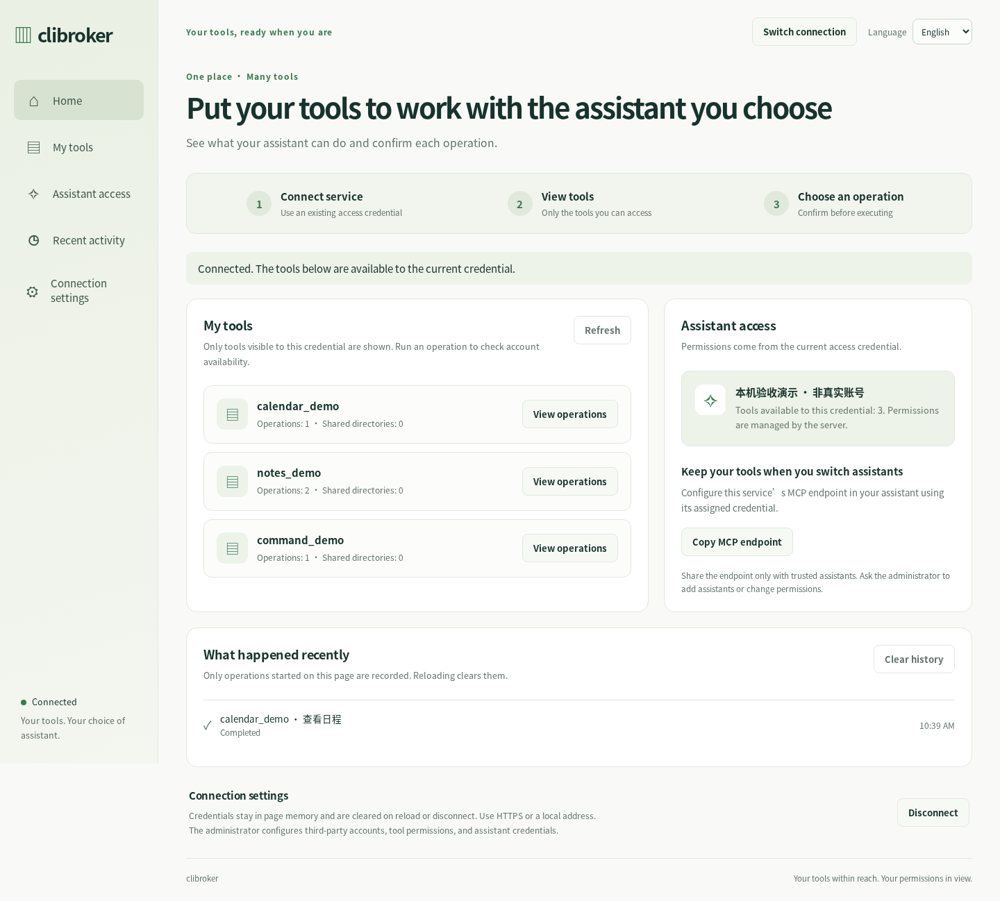
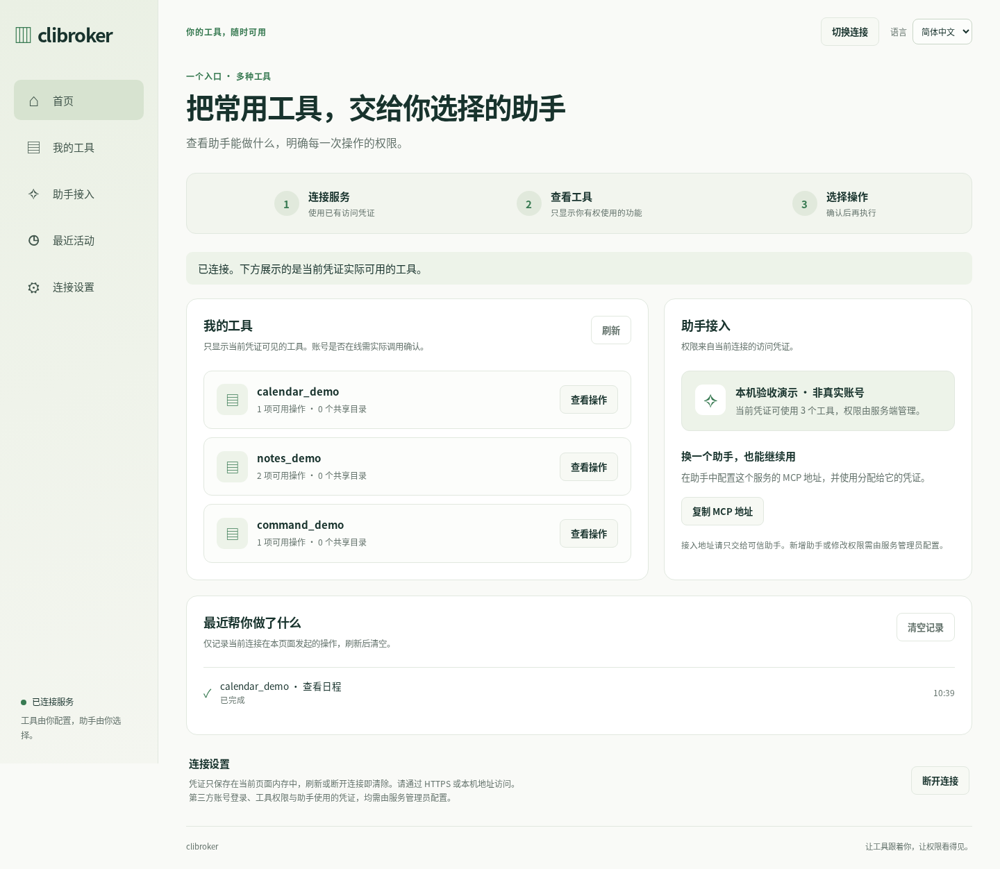
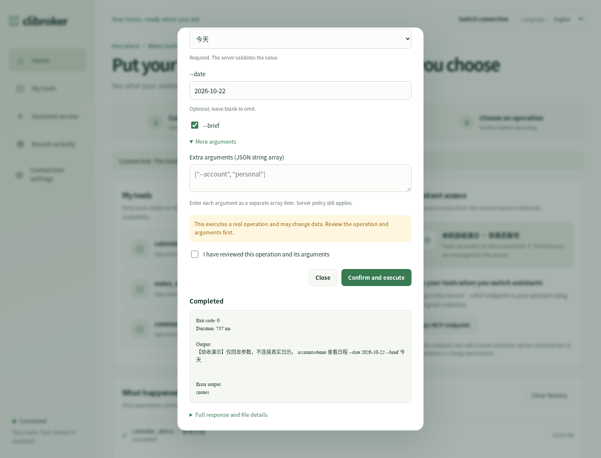
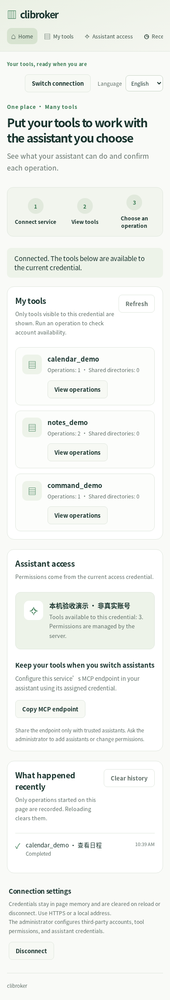

# 简体中文与英文验收记录

验收日期：2026-10-22（UTC）。在 PR #5 的现有面板上加入本地多语言字典，当前提供 **简体中文 `zh-CN` 与英文 `en`**。

## 实现范围

- 主页面、连接弹窗、操作弹窗都有带可访问名称的语言选择器。界面文字、动态状态、参数说明、校验错误、网络错误、结果标签、历史状态和时间格式随所选语言切换；同步更新页面标题、`html lang`、占位提示和可访问标签。
- 首次从 `navigator.languages` 按顺序匹配现有语言或对应语言族，未知语言回退英文；中文语言族使用当前提供的简体中文。显式选择优先于浏览器语言。
- 仅在本地存储写入 `clibroker.language`，值只能为 `en` 或 `zh-CN`。无法使用浏览器存储时，当前页面仍可切换语言；不会保存凭证、请求参数、结果或活动。切换凭证、断开和重载均不保存连接。
- 切换语言原位更新弹窗文字，不重建输入框，不丢失连接、参数或确认状态。修改参数仍会取消确认；执行中表单继续锁定，语言选择器仍可使用，不触发重复请求。
- 工具名、凭证名称、命令、规则名、参数名称、枚举值、正则约束和服务输出均为服务数据，保留原文。英文截图中出现的中文演示名称与输出正是这一行为，不代表未翻译的界面文字。
- 使用同源静态字典，不请求外部翻译服务，不增加前端构建步骤。后端认证、策略、权限和内容安全策略保持既有实现。

字典及可选语言位于 `src/clibroker/dashboard/i18n.js`。扩展语言时需提供相同消息键与插值字段；选择器会自动使用语言列表。当前不声称其他语言已翻译。

## 测试环境与命令

复用隔离环境：Python 3.13.5、MCP 1.30.0、Playwright 与真实 Chromium 156.0.8078.4。Python 服务只监听 `127.0.0.1:8876`，使用临时生成的演示凭证。工具仅回显示例参数；为观察执行中切换语言，另用延迟约 0.7 秒后打印参数的临时 Python 演示程序。没有连接真实账号，没有替换接口响应冒充第三方结果。

在仓库目录执行：

```bash
node --test tests/dashboard_i18n.test.cjs
<隔离虚拟环境>/bin/python -m pytest tests -v --basetemp=<临时目录>/pytest-i18n
```

- 字典与语言协商测试：**4 项通过，0 失败**。检查浏览器语言顺序、保存偏好、未知语言回退、字典键和插值字段一致性、原始数据插值以及 HTML 的翻译引用。见[Node 日志](acceptance/dashboard-i18n-node.log)。
- 现有 Python 测试：**187 项通过，5.66 秒，退出码 0**。见[pytest 日志](acceptance/dashboard-i18n-pytest.log)，日志中的本机目录已替换为 `<workspace>`。
- 原有中文浏览器验收已重新运行并通过，包括权限过滤、真实执行、通配命令、刷新、断开、直接访问 `index.html` 和窄屏。原来的“存储必须为空”断言已调整为“仅允许受支持的语言代码，会话存储为空”。
- 下表为另行执行的多语言专项浏览器验收；[原始诊断](acceptance/dashboard-i18n-browser.json)保留每项通过记录。

## 真实浏览器结果

| 场景 | 实际结果 |
| --- | --- |
| 英文浏览器首次进入 | 自动显示英文；标题、导航、页面语言和可访问标签正确 |
| 连接弹窗内切换 | 输入内容保留；已有必填错误与真实 HTTP 401 错误随语言重新显示 |
| 正在连接时切换 | “连接中”文字立即变化；真实发现请求完成，工具权限范围正确 |
| 操作弹窗内往返切换 | 全局参数、位置参数、值参数、开关和确认勾选均保留；修改参数后仍取消确认 |
| 未确认与非法 JSON | 未确认时没有执行请求；JSON 字符串数组校验错误可在中英文之间重新显示 |
| 执行中切换 | 真实演示子进程执行期间仍锁定参数，仅发出一次执行请求，完成后重新要求下一次确认 |
| 结果与活动切换 | 已有成功结果标签和历史状态被翻译；原始 JSON 与服务输出保持逐字一致 |
| 多值参数 | 多值标签、正则说明、枚举说明和至少一项的校验均可切换，实际数组数据未翻译 |
| 时间显示 | 历史时间与当前语言的 `toLocaleTimeString` 一致，日期提示也按语言重新格式化 |
| 重载记住偏好 | 英文与中文选择分别可跨重载保留；连接和凭证均不会跨重载保留 |
| 离线错误 | 浏览器真实离线导致网络失败，错误文字可切换；恢复网络后能刷新工具 |
| 权限与存储 | 切换受限凭证只显示一个获授权工具；断开后只留下语言代码，无凭证或结果 |
| 手机英文 | 390 × 844 视口完成连接和真实执行；390 与 320 像素宽度均无页面横向溢出 |
| 未知语言与受限存储 | 法文浏览器回退英文；存储被浏览器禁用时仍可在当前页面切换 |
| 控制台与网络 | 无页面异常、无意外控制台错误、无外部请求；预期的 401 和主动离线网络失败单独记录 |

## 新截图

这些截图均来自本次真实运行，没有用图像生成或旧图替代。未展示访问凭证或敏感 MCP 地址。

### 英文首页



### 简体中文首页



### 英文执行结果

结果标签为英文，演示服务的中文数据保持原文。



### 英文手机页面



## 范围与限制

仅提供并验收简体中文和英文；其他界面语言尚未翻译。没有验收真实第三方账号、OAuth、助手到 MCP 的端到端连接、远程 HTTPS/代理、Firefox、Safari 或实体手机，也未穷举全部 HTTP 错误或等待完整的 120 秒请求超时。

已知后端与 MCP 2.x 的导入兼容问题仍存在，本次使用 MCP 1.30.0，未修改依赖约束。截图检查发现给导航文字添加翻译节点会继承原图标的固定宽度，已把图标样式限定到 `aria-hidden` 元素，并完整重跑专项浏览器验收后截取最终图片。

没有部署或合并 PR。
